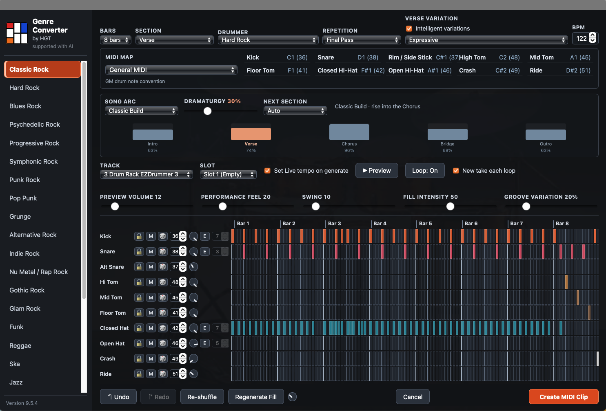

# Genre Converter

### by HGT · Developed with AI assistance

**Build complete drum arrangements. Shape the groove. Give every song its own development.**

Genre Converter is an independent Ableton Live extension for creating genre-based MIDI drum arrangements. It combines genre-specific groove engines, drummer profiles, fills, song-section development and arrangement-level musical dramaturgy.

Instead of relying on a static loop, Genre Converter helps build drum parts that evolve across Intro, Verse, Chorus, Bridge and Outro sections.

---

## 1. Key Features

### Genre-Based Drum Generation

Choose from 25 selectable musical genres and genre variations, including:

- Classic Rock and Alternative Rock
- Blues, Jazz and Jazz-Funk
- Punk and Proto-Punk
- Funk and New Orleans Funk
- Reggae and Dub
- Ska and Two Tone
- Hip-Hop, Drum & Bass and Jungle
- DanceBeatz and additional style variations

Each genre uses its own groove vocabulary, rhythmic character and specialized pattern or fill logic.

### Drummer Profiles & Performance Feel

Shape the playing character of the generated performance.

- **Drummer Profiles:** Choose genre-oriented drummer characters.
- **Performance Feel / Pocket:** Adjust the amount of human timing nuance.
- **Swing:** Apply the genre's supported 8th- or 16th-note swing feel.
- **Groove Variation:** Control variation within the generated groove.
- **Velocity Dynamics:** Shape accents, ghost notes and performance expression.

### Song Sections & Arrangement

Build a complete drum arrangement with individual song sections:

- Intro
- Verse
- Chorus
- Bridge
- Outro

Sections can have their own musical settings and development. Genre and drummer character can shape the performance across the arrangement.

### First / Second / Final Pass

Create subtle development between repeated song sections. Pass intelligence can make restrained changes between the First, Second and Final Pass while retaining the identity of the original groove.

### Fill Engine

Generate genre-aware fills and transitions. Fill logic responds to genre, section and repetition context. Fill intensity and variation controls shape the character of transitions.

### Song Dramaturgy

Shape the energy curve of the arrangement with four musical arc presets:

- **Classic Build**
- **Slow Burn**
- **Drop & Return**
- **Cinematic Rise**

Dramaturgy Strength blends the selected arc with the established section-energy behaviour. Next Section can be set automatically or directed to a chosen section or Song End.

### MIDI Map & Lane Controls

Use MIDI mapping options to match generated drum notes to the destination instrument. Lane locks protect selected drum lanes from unwanted changes during supported generation and refinement operations.

Third-party product names used in MIDI mapping identify note assignments only. They do not indicate that audio recordings, samples, presets or software from those manufacturers are included.

### Audio Preview

Audition the generated drum performance before using it in your Ableton Live arrangement.

- Preview playback and Stop control
- Preview mixer and lane routing
- Stereo panning and level controls
- Velocity-layer playback
- Preview level protection

---

## 2. How to Use

**Step 1 – Choose a Genre**

Select the musical style that provides the foundation for your drum arrangement.

**Step 2 – Set the Tempo and Groove**

Adjust BPM, Performance Feel / Pocket, Swing and Groove Variation.

**Step 3 – Choose a Drummer Character**

Select a Drummer Profile and adjust the performance settings.

**Step 4 – Shape the Song Sections**

Work with Intro, Verse, Chorus, Bridge and Outro. Set section development and pass behaviour.

**Step 5 – Configure Fills and Song Dramaturgy**

Choose fill behaviour and, if desired, a Song Arc preset and Next Section transition.

**Step 6 – Preview and Create MIDI**

Audition the result, refine the settings and generate the MIDI arrangement for further editing in Ableton Live.

**Closing the Extension Without Generating MIDI**

If you want to close the extension without generating or inserting MIDI clips, simply click the **Cancel** button.

This closes the extension without creating or transferring any MIDI data to Ableton Live. Existing clips and MIDI content remain unchanged.

---

## 3. Installation & Requirements

### System Requirements

- Ableton Live Suite with Extensions support.
- Ableton Live version with JavaScript Extensions support; check the current Ableton release notes for version and beta availability.
- macOS or Windows systems supported by the corresponding Ableton Live version.

**Important:** Ableton Extensions are not available in Live Standard, Intro or Lite.

### Installation

1. Download the latest `.ablx` file from GitHub Releases.
2. Open Ableton Live.
3. Navigate to **Settings / Preferences → Extensions**.
4. Select **Install Extension** and choose the downloaded `.ablx` file. Alternatively, drag the `.ablx` file onto the Extensions settings page.
5. Restart Live if required.

### Updates

1. Visit the GitHub Releases section.
2. Download the latest `.ablx` package.
3. Install the updated extension through Live's Extensions settings.
4. Restart Live if required.

---

## 4. Compatibility & Technology

- Developed for Ableton Live using the Ableton Extensions SDK.
- Distributed as an installable Ableton Extension (`.ablx`).
- The required runtime is included in the extension.
- Rebuilding from source requires the Ableton Extensions SDK and CLI, available separately from Ableton.

No additional SDK installation is required to use the pre-built `.ablx` package.
---

## 5. Audio Assets, Sources & Licenses

### Audio Preview — Phazite Sounds

The Genre Converter preview uses 37 embedded MP3 sound assets derived from **Phazite Sounds**, declared under the **CC0 1.0 Universal** dedication.

- **Sound source:** [Phazite Sounds](https://github.com/august-byrne/phazite-sounds)
- **License:** [CC0 1.0 Universal](https://creativecommons.org/publicdomain/zero/1.0/)

The sound set includes four velocity layers each for Kick, Snare, Rim / Side Stick, Low Tom, Mid Tom, High Tom, Closed Hi-Hat, Open Hi-Hat and Ride, plus one dedicated Crash sound.

The sounds are embedded in the extension. The original WAV/FLAC recordings are not distributed separately in the source archive.

### Artwork

The HGT banner, logo and visual elements are original artwork created by HGT, with AI assistance based on HGT's own descriptions and creative direction. Their geometric visual language is inspired by Piet Mondrian; they are not reproductions of Mondrian artworks.

### MIDI Mapping Compatibility

The names Toontrack / EZdrummer, Native Instruments Battery / Kontakt and Korg are used only to identify MIDI note mappings. No recordings, samples, presets or software from these manufacturers are included.

### Project and Third-Party Licenses

The HGT Free Music Creator License 1.0 applies to original Genre Converter project material owned or controlled by HGT.

The unmodified extension can be used free of charge for personal, educational, professional and commercial music production. Music created with it may be edited, released and monetized.

The HGT license is separate from the CC0 dedication for the Phazite sound assets and the Ableton Extensions SDK license.

For complete details, see the documentation included in the source package and available in the repository:

- [LICENSE.md](https://github.com/hgtroester-ai/genre-converter/blob/main/Documentation/LICENSE.md) — HGT Free Music Creator License 1.0
- [THIRD-PARTY-NOTICES.md](https://github.com/hgtroester-ai/genre-converter/blob/main/Documentation/THIRD-PARTY-NOTICES.md) — third-party components and notices
- [SOUND-ASSETS.md](https://github.com/hgtroester-ai/genre-converter/blob/main/Documentation/SOUND-ASSETS.md) — sound source and asset details
- [SOUND-ASSET-MANIFEST.json](https://github.com/hgtroester-ai/genre-converter/blob/main/Documentation/SOUND-ASSET-MANIFEST.json) — sound asset verification data
- [RELEASE-NOTES-9.6.3.md](https://github.com/hgtroester-ai/genre-converter/blob/main/Documentation/RELEASE-NOTES-9.6.3.md) — release notes
- [SOUND-PROVENANCE-9.6.3.md](https://github.com/hgtroester-ai/genre-converter/blob/main/Documentation/SOUND-PROVENANCE-9.6.3.md) — sound provenance
- [LEGAL-RELEASE-CHECKLIST-9.6.3.md](https://github.com/hgtroester-ai/genre-converter/blob/main/Documentation/LEGAL-RELEASE-CHECKLIST-9.6.3.md) — release documentation checklist

For the central documentation covering all three HGT Ableton Extensions:

- [Sources & Documentation](https://github.com/hgtroester-ai/hgt-ableton-extensions/tree/main/Documentation)
- [Sources — English](https://github.com/hgtroester-ai/hgt-ableton-extensions/blob/main/Documentation/SOURCES.md)
- [Quellen — Deutsch](https://github.com/hgtroester-ai/hgt-ableton-extensions/blob/main/Documentation/SOURCES_DE.md)

---

## 6. Use and Responsibility

This extension is developed by HGT on a voluntary basis and provided free of charge.

It is developed and tested with care, but errors or compatibility issues cannot be completely ruled out. Use is at your own responsibility.

Please save and back up your Ableton Live projects and related files regularly, especially before installing or updating this extension.

No guarantee of error-free or uninterrupted operation is provided. Liability for damages or data loss is excluded to the extent permitted by applicable law. Mandatory statutory rights remain unaffected.

---

## 7. Downloads

**Latest release: Genre Converter 9.6.3**

- [Download installable Ableton Extension (.ablx)](https://github.com/hgtroester-ai/genre-converter/releases/download/v9.6.3/Genre_Konverter_9.6.3.ablx)
- [Download complete source code (.zip)](https://github.com/hgtroester-ai/genre-converter/releases/download/v9.6.3/Genre_Konverter_9.6.3_source.zip)

Check [GitHub Releases](https://github.com/hgtroester-ai/genre-converter/releases) for version numbers, updates and release notes.

---

## 8. About HGT

**The only good system is a sound system.**

Music connects people.

Independent development, creative ideas and a passion for music.

**HGT – Developed with passion. Shared freely.**

Free to use. Independently developed.
